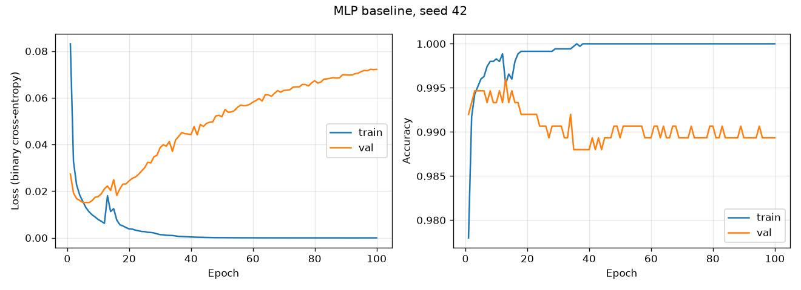

# MLP baseline on ECG5000: results

Script: [`tushaar/baseline_nn.py`](../baseline_nn.py). Outputs are in this folder (`tushaar/results/`).
Dataset: `data/dataset_` (ARFF, ECG5000). 4998 rows, 140 features (`col_0`..`col_139`), binary label `class` (0/1).

## Headline

| | Test accuracy | F1 | ROC-AUC | Train time (s) |
|---|---|---|---|---|
| Seed 42 (reference) | 0.9880 | 0.9897 | 0.9972 | 25.8 |
| Seeds 0–4, mean ± std (ddof=1) | 0.9880 ± 0.0021 | 0.9897 ± 0.0018 | 0.9973 ± 0.0012 | 22.4 ± 1.9 |

Op determinism (`tf.config.experimental.enable_op_determinism()`): **enabled**.

## Setup

| Setting | Value |
|---|---|
| Architecture | Input(140) → Dense(64, relu) → Dense(32, relu) → Dense(1, sigmoid) |
| Parameters | 11,137 trainable (matches the expected count) |
| Initialisers | Glorot uniform kernels, zero biases (Keras defaults) |
| Regularisation | None (no dropout, batch norm or weight penalties) |
| Loss / optimizer | binary_crossentropy / Adam(learning_rate=0.001) |
| Training | 100 epochs, batch size 32, shuffle=True, no callbacks or early stopping |
| Split | Stratified on class, split seed 42: 70 / 15 / 15 → 3498 / 750 / 750 rows (class 1 = 58.40% in each) |
| Split method | Two `train_test_split` calls (70/30, then the 30% halved). Reuse `split_indices.npz` to get the same rows |
| Scaling | Per-feature z-score using the train set's mean and population std (ddof=0) |
| Threshold | Predict 1 when prob > 0.5 |
| Seeding | `keras.utils.set_random_seed(seed)` before building each model; the seed controls only initialisation and shuffling |
| Environment | Python 3.12.10, numpy 2.5.5, pandas 3.1.1, TensorFlow 2.21.0, Keras 3.15.1, scikit-learn 1.9.1, scipy 1.18.1, matplotlib 3.11.2 |
| Hardware | Windows 11 (10.0.26300), Intel Core i5-10300H, CPU only (TensorFlow has no GPU support on native Windows) |

## Model summary

```
Model: "sequential"
┌─────────────────────────────────┬────────────────────────┬───────────────┐
│ Layer (type)                    │ Output Shape           │       Param # │
├─────────────────────────────────┼────────────────────────┼───────────────┤
│ dense (Dense)                   │ (None, 64)             │         9,024 │
├─────────────────────────────────┼────────────────────────┼───────────────┤
│ dense_1 (Dense)                 │ (None, 32)             │         2,080 │
├─────────────────────────────────┼────────────────────────┼───────────────┤
│ dense_2 (Dense)                 │ (None, 1)              │            33 │
└─────────────────────────────────┴────────────────────────┴───────────────┘
 Total params: 33,413 (130.52 KB)
 Trainable params: 11,137 (43.50 KB)
 Non-trainable params: 0 (0.00 B)
 Optimizer params: 22,276 (87.02 KB)
```

Keras's "Total params: 33,413" counts the 22,276 Adam optimizer slots as well. The model itself has 11,137 parameters.

## Per-run test metrics

| Seed | Test loss | Accuracy | Precision | Recall | F1 | ROC-AUC | TN | FP | FN | TP | Time (s) |
|---|---|---|---|---|---|---|---|---|---|---|---|
| 42 | 0.2140 | 0.9880 | 0.9908 | 0.9886 | 0.9897 | 0.9972 | 308 | 4 | 5 | 433 | 25.8 |
| 0 | 0.1668 | 0.9867 | 0.9886 | 0.9886 | 0.9886 | 0.9975 | 307 | 5 | 5 | 433 | 25.7 |
| 1 | 0.1273 | 0.9907 | 0.9954 | 0.9886 | 0.9920 | 0.9987 | 310 | 2 | 5 | 433 | 22.3 |
| 2 | 0.1145 | 0.9893 | 0.9931 | 0.9886 | 0.9908 | 0.9976 | 309 | 3 | 5 | 433 | 21.0 |
| 3 | 0.2367 | 0.9853 | 0.9863 | 0.9886 | 0.9875 | 0.9954 | 306 | 6 | 5 | 433 | 21.8 |
| 4 | 0.1572 | 0.9880 | 0.9931 | 0.9863 | 0.9897 | 0.9974 | 309 | 3 | 6 | 432 | 21.5 |

Each confusion matrix is laid out as `[[TN, FP], [FN, TP]]`.

## Training behaviour

| Seed | Final train loss | Final train acc | Final val loss | Final val acc | Lowest val loss | At epoch |
|---|---|---|---|---|---|---|
| 42 | 2.1e-6 | 1.0000 | 0.0722 | 0.9893 | 0.0151 | 7 |
| 0 | 9.6e-7 | 1.0000 | 0.1319 | 0.9920 | 0.0192 | 5 |
| 1 | 3.1e-6 | 1.0000 | 0.0739 | 0.9960 | 0.0239 | 5 |
| 2 | 1.1e-6 | 1.0000 | 0.0899 | 0.9907 | 0.0193 | 3 |
| 3 | 1.1e-6 | 1.0000 | 0.1214 | 0.9920 | 0.0193 | 4 |
| 4 | 1.4e-6 | 1.0000 | 0.0933 | 0.9920 | 0.0193 | 3 |



What the curves show:
- Validation loss is lowest between epochs 3 and 7, then rises steadily. On seed 42 it goes from 0.015 to 0.072 by epoch 100, while train loss falls to about 2e-6.
- Validation accuracy stays around 0.99 throughout.
- Test loss varies between seeds (0.11–0.24), but test accuracy barely changes. Many predicted probabilities are exactly 1.0.

## Caveats

- Op determinism was enabled without error. Nobody has yet rerun a seed to confirm the results are bit-identical.
- oneDNN optimisations were on (TensorFlow's default on CPU).
- The aggregate std is the sample std (ddof=1) over seeds 0–4. Seed 42 is not included in the aggregate.

## Files in this folder

| File | Contents |
|---|---|
| `split_indices.npz` | `train_idx`, `val_idx`, `test_idx` (row indices into the dataset) |
| `scaler_stats.npz` | `mean`, `std` (140 values each, from the train set) |
| `history_seed{42,0,1,2,3,4}.csv` | Loss, accuracy, val_loss and val_accuracy for each epoch |
| `test_predictions_seed{42,0,1,2,3,4}.csv` | Row index, true label, predicted probability, predicted label |
| `initial_weights_seed42.npz`, `final_weights_seed42.npz` | Kernel and bias of each of the three Dense layers |
| `model_seed42.keras` | The trained seed-42 model |
| `curves_seed42.png` | Train vs val loss and accuracy curves |
| `metrics.csv`, `metrics_aggregate.csv` | Per-seed metrics (full precision), and the mean/std over seeds 0–4 |
| `config.json` | Every setting, package versions, OS and CPU |
| `summary.txt` | The script's printed summary |
